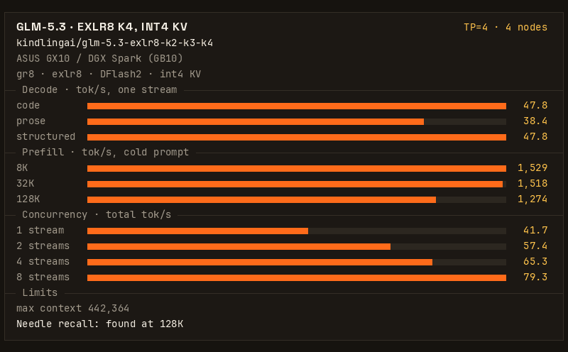

# KindlingAI: GLM-5.3 EXLR8 K4 on four DGX Sparks

If you are an agent booting this for someone, read [AGENTS.md](AGENTS.md) first, then the Quickstart.

_**Join our discord to learn more about KindlingAI and `gr8`: https://discord.gg/8EAvYPV2rE**_

GLM-5.3 on four DGX Sparks (GB10, 128 GB each), served by [gr8](https://github.com/kindlingai/gr8) from the `bit387`
profile of [kindlingai/glm-5.3-exlr8-k2-k3-k4](https://huggingface.co/kindlingai/glm-5.3-exlr8-k2-k3-k4) (0.7): every
routed expert at 4 bits a weight except the first ten MoE layers (3-12) at 3, and the MTP layer at 3, the only width
the release stores for it. `bit387` is statistically identical to the all-K4 `bit400`: full-vocabulary KL against
BF16 of 0.0385 against 0.0381 on model-written text (1.5 standard errors apart), in 12 GB less (89 against 92 GB of
experts per box). The recipe carries a copy of the release's manifest (`manifests/exlr8-manifest-bit387.json`). The
KV cache is int4, on the four boxes.



## What you need

- Four DGX Sparks, or other GB10 boxes such as the ASUS GX10, joined by their ConnectX ports (a switch, or cables
  between the boxes).
- Docker and the NVIDIA container toolkit on each box (both come with DGX OS).
- About 110 GB free on each box for its part of the model.
- Proactive memory compaction off on each box, as root, once:

  ```bash
  echo 'vm.compaction_proactiveness = 0' > /etc/sysctl.d/90-gr8-no-proactive-compaction.conf
  sysctl -w vm.compaction_proactiveness=0
  ```

## Quickstart

On each of the four boxes:

```bash
git clone https://github.com/kindlingai/glm-5.3-exlr8-k4-4x-spark
cd glm-5.3-exlr8-k4-4x-spark
cp .env.example .env        # fill in PEERS (and IPS, IPS2) unless the boxes run mentat; the same file on every box
docker compose up -d
```

The first boot fetches each box's part of the model from Hugging Face. Then the boxes find each other, and the head
(the first address in `PEERS`) serves the OpenAI API on port 8100:

```bash
docker compose logs -f                                  # ready when it says the cluster serves
docker compose exec gr8 /opt/gr8/gr8 glm53 smoke        # on the head
curl http://localhost:8100/v1/models                    # on the head
```

Stop and update:

```bash
docker compose exec gr8 /opt/gr8/gr8 glm53 down         # on the head: stops every box
git pull && docker compose pull && docker compose up -d # on every box
```

## Knobs

The recipe sets the model, the `bit387` manifest and four boxes, and trades some decode speed for memory: decode graphs
for three context sizes (`DEC_BK=16384`, `DEC_BK_MAX=32768`) and a fixed MTP draft count (`S2_ADAPT=0`). The K4
experts leave no room for gr8's defaults and a KV pool (`Dockerfile`). One session can be 432K tokens long
(`CAP=442368`), and `SHARE_LIMIT=16384` lets four sessions of about 74K tokens share the pool. Every other option is
gr8's launcher default, listed in
[gr8/KNOBS.md](https://github.com/kindlingai/gr8/blob/2f3b287c4749e377b8ff42335503670d0f086594/KNOBS.md).
Set any of them in `.env`, the same line on every box.

- `PEERS`, `IPS`, `IPS2`: the boxes' addresses (`.env.example`). Unset, the boxes find each other through mentat.
- `DISPRAM`: 1 (the recipe's setting) lends each box's 2 GiB display memory to the KV cache when Kindling OS runs
  `dispramd`. 0 turns it off.

## Help

Questions and problems: the Discord above, or an issue on [gr8](https://github.com/kindlingai/gr8/issues).
